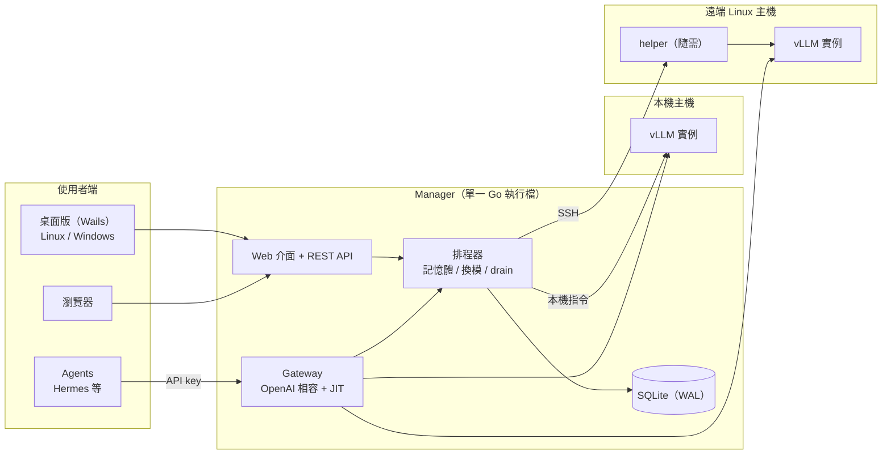

# LM-Switchyard 設計文件

**Next-Gen Model Manager**：跨平台的 vLLM 管理軟體，支援 Linux、Windows 與 Web。

- 狀態：草案，待確認。確認前不開始寫程式。
- 日期：2026-10-14
- 依據：2026-10-13 至 10-14 的設計訪談，共 38 項決定（附錄 A 逐條列出）。
- 第 10 節是訪談沒問到、由我補上的預設值，請一併確認。

---

## 1. 定位

- **用途**：先自用，同時以開源專案發布（Apache-2.0）。
- **目標使用者**：擁有 1 到 4 台 GPU 主機、不想導入 Kubernetes 的團隊、實驗室與地端 PoC。
- **和現有工具的差異**：
  - vLLM Playground 是單人開發工具，GPUStack 是要求重建環境的完整叢集平台，llama-swap 只管單機換模。
  - 本專案的核心是**非侵入式納管**：直接接手主機上既有的 vLLM，不要求重建環境。
  - 在這之上提供五項能力：
    1. 納管本機與遠端 Linux 的 vLLM
    2. 多國語系介面（含台灣正體中文）
    3. 每個 agent、每個 session 的 TTFT、tok/s 歷史紀錄與曲線
    4. Hugging Face 模型庫整合下載
    5. 給 Hermes Agent 等 agent 使用的 JIT 換模
- **分工**：Claude 撰寫程式，Moses 測試驗證。

---

## 2. 名詞

| 名詞 | 定義 |
|---|---|
| Manager | 中央服務：Web 介面、REST API、gateway、排程器、資料庫，編成單一執行檔，以 Linux systemd 服務或 Windows 服務執行 |
| 主機（Host） | 被管理的 GPU 機器，可以是 Manager 所在的本機，或透過 SSH 連線的遠端 Linux |
| helper | Manager 透過 SSH 放到主機使用者家目錄的小型執行檔，負責探索、指標、下載。用完即結束，不註冊服務，移除主機時一併清除 |
| 實例（Instance） | 一個 vLLM 伺服器行程，可以是容器或 venv 行程 |
| 納管實例（Adopted） | 主機上原本就有的 vLLM：可以看指標和日誌、可以手動啟停，但 Manager 絕不自動停止它，它也不參與 JIT |
| 託管實例（Managed） | 由 Manager 建立的實例：完整生命週期，參與 JIT |
| 轉為託管 | 讀取納管實例原本的參數，重建成託管實例 |
| 模型項目（Model entry） | 模型庫中的一筆：名稱、主機優先順序、vLLM 參數、釘選、換下策略 |
| Gateway | OpenAI 相容代理，所有 agent 請求的唯一入口 |
| Agent | 持有一把 API key 的呼叫端，key 就是它的身分 |
| Session | 同一把 key 的連續請求，閒置超過 15 分鐘就切成新 session。請求若帶 `X-Session-Id` header 或 OpenAI 的 `user` 欄位，以該 ID 為準，不同 ID 分開計算 |
| JIT 換模 | 請求的模型還沒載入時，自動騰出記憶體、載入該模型，再把請求送過去 |
| Hold | JIT 載入期間掛住請求等待，而不是回錯誤 |
| Drain | 要換下的實例還有進行中的請求時，先等這些請求跑完 |
| 釘選（Pin） | 標記為永不被 JIT 換下的模型 |
| Sleep L1 / L2 | vLLM Sleep Mode。L1 把權重搬到主機 RAM，喚醒快；L2 直接丟棄權重，喚醒時從磁碟重新載入 |
| 能力探測 | 主機加入時實測的項目：GPU 廠牌、記憶體模式、Sleep Mode 是否可用 |

---

## 3. 架構

- **Manager**：Go 撰寫的單一執行檔，內嵌 React + TypeScript 前端。安裝時下載一個檔案、執行 install 就會註冊成 systemd 服務或 Windows 服務，主機上不必先裝 Python、Node 或 Docker。
- **名稱**：執行檔與服務名稱都是 `lm-switchyard`，CLI 另有短名 `lmsy`。
- **Windows 上的 Manager**：只管理遠端 Linux 主機。Windows 本機跑 vLLM 屬於第二階段（WSL2）。
- **桌面版**：Wails v2 包同一套前端，當薄客戶端連到一台或多台 Manager，另提供系統匣通知。
- **資料**：所有設定、指標、日誌索引都存在 Manager 內嵌的 SQLite，不另外安裝資料庫。

---

## 4. 功能規格

### 4.1 主機與納管

- **新增主機**：localhost 或 SSH（金鑰驗證）。
  - SSH 帳號需要在 `docker` 群組裡。
  - sudo 是選配：沒有 sudo 時，由 systemd 啟動的 vLLM 只能看、不能啟停。
- **helper 的工作**：
  - 自動探索既有的 vLLM：Docker 容器、systemd 服務、裸行程。
  - 收集 GPU 指標：NVIDIA 用 `nvidia-smi`，AMD 用 `amd-smi`。
  - 執行模型下載並回報進度。
- **能力探測**：主機加入時實測 GPU 廠牌、記憶體模式（獨立顯卡、UMA carve-out、UMA GTT），以及 Sleep Mode 是否真的能用。Sleep 能不能用由實測結果決定，不按廠牌寫死。
- **託管實例的兩種執行形式**：
  - Docker：使用官方映像檔，每個實例可指定映像檔與版本。
  - Python venv：可以讓 Manager 用 uv 自動建立（每個 vLLM 版本一個 venv，多個實例共用，下載快取也共用；AMD 主機自動改用 ROCm 套件索引），也可以指定一個已經裝好 vLLM 的 venv 路徑。uv 由 helper 一起帶上主機。
- **轉為託管**：讀取納管實例的容器參數或啟動指令，重建為託管實例。

### 4.2 Gateway 與 JIT

- **端點**：`/v1/chat/completions`、`/v1/completions`、`/v1/embeddings`、`/v1/models`。
- **`/v1/models`**：列出模型庫的全部模型，包含還沒載入的。Hermes 這類 agent 不用改程式，直接拿這份清單選模型。
- **未載入的模型被請求時**：
  1. **Hold**：請求掛住等待。串流請求在等待期間定時送出 SSE 註解行維持連線。等待上限預設 10 分鐘。
  2. **選主機**：照模型的主機優先順序，找第一台放得下的主機載入。同一時間只有一份副本。
  3. **騰出記憶體**：多個模型可以並存，記憶體不夠時才換下最久沒用的模型。釘選的模型不換下。如果空間被納管實例佔住，不硬搶，直接回報原因。
  4. **Drain**：要換下的實例還有進行中的請求時，最多等 60 秒，逾時就中斷，並在儀表板標記被中斷的請求。
- **可調參數**：等待上限、drain 秒數都有全域預設，每個模型可以個別覆寫。
- **記憶體分配**：獨立顯卡上，Manager 自動分配各實例的 `--gpu-memory-utilization`。
- **換下策略**：
  - 預設自動判斷：Sleep 可用且主機 RAM 夠，就用 L1；否則用 L2 或完全卸載。
  - 每個模型可以個別覆寫。
  - Sleep 不可用的主機一律冷啟動，並在儀表板標示。
- **統一記憶體（UMA）規則**，例如 Radeon 8060S：
  - 可排程記憶體 = 偵測值 − 保留給 OS 的量（預設 16 GB），可以手動覆寫。
  - GTT 模式：停用 L1。L1 是把權重搬到主機 RAM，而 GTT 模式下那和 GPU 用的是同一塊實體記憶體，搬了也騰不出空間。
  - carve-out 模式：系統 RAM 那一區還有空間時才用 L1。
- **API key**：
  - 每個 agent 一把，沒帶 key 的請求一律拒絕。
  - 每把 key 有名稱，建立後只顯示一次。
  - 權限有兩項：可以使用哪些模型（預設全部）、能不能觸發 JIT 換模（預設可以）。

### 4.3 儀表板與指標

每個請求記錄以下欄位：

| 欄位 | 定義 |
|---|---|
| agent、session、模型、主機 | 來源與去向 |
| TTFT | 請求抵達 gateway 到收到第一個 token 的時間，**不含** JIT 等待 |
| tok/s | 輸出 token 數 ÷（最後一個 token 時間 − 第一個 token 時間） |
| 端到端延遲 | 請求抵達到回應結束 |
| 輸入／輸出 token 數 | 取自 vLLM 回應的 usage 欄位 |
| JIT 等待 | 這個請求觸發或碰上換模時等待的時間，獨立畫成一條曲線 |
| 中斷標記 | 是否在 drain 時被中斷 |

- **圖表**：可依 agent、session、模型分別看 TTFT 和 tok/s 的曲線與歷史紀錄，JIT 等待另外一條曲線。
- **保留期限**：逐筆明細 90 天，每小時彙總永久保留。

### 4.4 模型庫

- **相容性判斷**：從 Hugging Face 搜尋模型，讀取 `config.json` 的 `architectures`，比對目標主機上那個 vLLM 版本實際支援的架構。
- **下載前**：估算需要的記憶體，放不下就警告。
- **下載**：直接在目標主機上執行，不繞經 Manager。gated 模型使用存在 Manager 的 HF token。
- **既有模型目錄**：主機上已經下載好的模型可以直接納入模型庫，不用重下。
- **HF 鏡像端點**：可以設定 `HF_ENDPOINT`。
- **名稱**：預設用 HF repo id（例如 `taide/Gemma-3-TAIDE-12b-Chat`），可以改成短別名，對應 vLLM 的 `--served-model-name`。
- **多主機**：一個模型項目可以列多台主機並排優先順序。列在清單上的每台主機都要有一份權重。

### 4.5 介面與語系

- **12 種語系**：en、zh-TW、de、fr、it、es（不分地區的通用版）、pt-BR、ja、ko、zh-CN、th、vi。
- **預設語言**：跟隨系統語言；不在清單內就退回英文；可以手動切換。
- **翻譯流程**：所有語系先由 AI 翻譯上線，沒經過人工審核的標示「Beta」，再開放 Weblate 讓社群校對。
- **不翻譯的詞**：GPU、VRAM、TTFT、token 這類技術詞。

### 4.6 安全

做法參照 LM Studio：

- **監聽位址**：預設只監聽 `127.0.0.1`，管理介面、API、gateway 共用一個埠。設定頁有「對區網開放」開關。
- **管理介面**：單一管理員帳號。多使用者、角色權限、LDAP/AD 列入路線圖。
- **TLS**：選配，可以匯入自己的憑證。只要監聽在 localhost 以外又沒開 TLS，介面就顯示警告。
- **遙測**：不收集任何遙測資料。

---

## 5. 技術棧與建置

| 項目 | 選擇 | 理由 |
|---|---|---|
| Manager、helper | Go 1.24 | 單一執行檔、處理大量串流連線和 SSH 很自然、跨平台編譯容易。版本鎖在 1.24，因為 Claude 的開發環境無法升級 Go |
| 前端 | React + TypeScript | 內嵌在 Manager 執行檔裡 |
| 桌面版 | Wails v2（v2.10.x） | 在 Linux 上就能編出 Windows 版，不需要 CGO 和 Microsoft SDK；和 Manager 同一個語言 |
| 資料庫 | SQLite（WAL 模式），純 Go 驅動 | 不需要 CGO，交叉編譯 Windows 版不會卡住 |
| 依賴 | 放進 repo 的 `vendor/` | Claude 的開發環境連不到 Go 官方模組伺服器；也讓專案可以在離線環境從原始碼建置 |
| 正式發行 | GitHub Actions | 建置 Linux 執行檔、Windows 服務執行檔、桌面版安裝檔，連同原始碼一起發佈到 Releases |
| Windows 程式碼簽章 | MVP 不簽 | 第一次執行會跳出 SmartScreen 警告 |

**依賴更新流程**：

1. Claude 修改 `go.mod`。
2. Moses 在 moses-server 執行 `tools/vendor.sh`（用 Docker 的 golang 映像檔執行，主機不必安裝 Go），再推上去。
3. Claude 的環境就能完整編譯 Linux 和 Windows 版。

新增依賴集中在每個里程碑開頭處理一次。HTTP、SSE、JSON 一律用 Go 標準函式庫。

---

## 6. 開發與驗收流程

- **開發**：Claude 在雲端工作區寫程式，並用模擬的 vLLM 跑單元測試；每個功能開一個 PR。
- **測試**：Moses 在 moses-server 上 `git pull`，用實機測試。
- **作者身分**：commit 作者為 `mosesmoon`，不加任何 Claude 共同作者標記，repo 的 contributors 不會出現 Claude。
- **驗收清單**：每個里程碑在 `docs/acceptance/Mx.md` 放一份，寫明指令與預期結果。Moses 逐項回報，沒通過的項目開 GitHub Issue 並附上日誌。
- **時程**：不排日期，每個里程碑做完就交付驗收。

---

## 7. 測試環境與支援等級

| 主機 | 規格 | 角色 | 驗收重點 |
|---|---|---|---|
| moses-server | Linux、Radeon 8060S（gfx1151，UMA） | Manager 主機、本機納管、AMD 正式驗證 | 納管既有 vLLM、JIT、UMA 記憶體規則、gfx1151 上的 Sleep Mode |
| Windows 11 桌機 | GeForce 3080 Ti（12 GB） | 桌面版、Windows 服務版 Manager、經 WSL2 驗證 NVIDIA | 桌面版安裝與連線、Windows 服務、WSL2 Ubuntu 作為遠端主機 |
| 780M 筆電 | Linux、Radeon 780M（gfx1103） | 遠端主機路徑 | SSH、helper、自動探索、指標、日誌、啟停 |

- **WSL2 那台的注意事項**：
  - WSL2 預設使用 NAT，moses-server 連不進去，要開 mirrored 網路模式或設定連接埠轉送。
  - vLLM 論壇有人回報在 WSL2 上啟用 Sleep Mode 時出現「system not supported」，目前沒有確定的解法。
  - 只有 12 GB VRAM，測試模型要挑 8B 以下的量化版。
- **780M 筆電**：據目前所知，780M 不在 ROCm 官方支援清單上，vLLM 不一定跑得起來。ROCm 跑不起來時，改用 vLLM 的 CPU 模式掛一個 0.6B 的小模型來測 JIT。
- **支援等級**：
  - AMD：正式支援，以 8060S 驗證。
  - NVIDIA：正式支援，以 3080 Ti 經 WSL2 驗證。
  - 其他 AMD 消費級 GPU：盡力支援（best-effort）。
  - Windows 原生 vLLM 的社群修改版：不支援。

---

## 8. 里程碑

| 里程碑 | 內容 | 驗收重點 |
|---|---|---|
| M0 硬體探針 | 一支探針腳本，回答五個未知數：moses-server 上的 vLLM 版本、gfx1151 的 Sleep Mode、8060S 的記憶體模式、WSL2 上的 Sleep Mode、Hermes 能否接受等待期間的 SSE 註解行 | 依探針結果定案 4.2 節的換下策略與 UMA 規則 |
| M1 骨架與納管 | 單一執行檔；systemd 與 Windows 服務安裝；管理員登入；新增主機（localhost、SSH）；helper；自動探索既有 vLLM；GPU 指標與日誌；zh-TW 與 en 介面 | 納管 moses-server 上現有的 vLLM；從 moses-server 納管 780M 筆電 |
| M2 Gateway 與儀表板 | OpenAI 相容代理；每個 agent 一把 key 與權限設定；session；TTFT、tok/s 量測；曲線圖 | Hermes 改指向 Manager 後，儀表板正確顯示每個 agent 與 session 的數據 |
| M3 託管與 JIT | Docker 與 venv 託管；HF 模型庫與下載；JIT 換模、hold、drain、釘選、Sleep；多主機優先順序 | Hermes 選到未載入的模型時自動換模；換下策略在三台主機上的表現符合規則 |
| M4 發行 | Wails 桌面版（Linux、Windows）；12 種語系與 Weblate；GitHub Actions 安裝檔；v0.1.0 | Windows 11 上安裝桌面版並連到 moses-server；發佈 v0.1.0 |

先做 M2 再做 M3，原因有二：gateway 是 JIT 的骨幹；而且 gateway 一接上現有的 vLLM，馬上就有儀表板可用。

---

## 9. 路線圖（MVP 之後）

- Windows 本機跑 vLLM（WSL2），以及 Windows 本機納管
- 多使用者、角色權限（RBAC）、LDAP/AD、稽核日誌（給客戶案場版本）
- 多副本負載平衡
- ModelScope、離線搬運匯入模型
- Podman
- Anthropic Messages API 格式
- ACME 自動申請憑證
- 一鍵自我更新（MVP 只會提示有新版本）
- Windows 程式碼簽章
- arm64 版本

---

## 10. 補上的預設值（訪談沒問到，請確認）

1. **預設埠**：8686，管理介面、API、gateway 共用，可以修改。
2. **祕密資料的存放**：
   - 管理員密碼和 agent API key 只存雜湊值。
   - SSH 私鑰和 HF token 用本機金鑰檔加密後存進 SQLite。金鑰檔只有服務帳號能讀。
3. **vLLM 實例日誌**：Manager 為每個實例保留最近 50 MB，滾動覆蓋。
4. **平台**：MVP 只出 x86_64（amd64）。
5. **桌面版打包**：Linux 出 AppImage，Windows 出 NSIS 安裝檔。
6. **文件語言**：設計文件用正體中文；README 與程式碼註解用英文，README 另外提供正體中文版。

---

## 11. 風險

| 風險 | 影響 | 對策 |
|---|---|---|
| vLLM 在 gfx1151 上還不成熟；Sleep Mode 在這顆 GPU 上找不到任何驗證紀錄 | AMD 的 JIT 可能只能冷啟動 | M0 先實測；Sleep 依能力探測結果啟用 |
| WSL2 上的 Sleep Mode 有錯誤回報 | NVIDIA 測試機的換模可能只能冷啟動 | 同上 |
| Claude 的開發環境連不到 Go 官方模組伺服器 | 每次新增依賴都要 Moses 執行 vendor 腳本 | 依賴集中處理、盡量用標準函式庫 |
| Go 版本鎖在 1.24，Wails 只能用 v2.10 | 拿不到較新版 Wails 的修正 | 正式發行由 GitHub Actions 建置；之後可以再升級 |
| 名稱和 NVIDIA NeMo Switchyard 相近 | 搜尋時可能混淆 | 一律使用完整名稱 LM-Switchyard |
| 未經人工審核的語系翻譯品質 | 部分語系用語不自然 | 標示 Beta，透過 Weblate 由社群校對 |

---

## 附錄 A：決策紀錄

| # | 主題 | 決定 |
|---|---|---|
| Q1 | 定位 | 自用加開源 |
| Q2 | Windows 的範圍 | MVP 的 Windows 只當管理端；本機跑 vLLM（WSL2）放第二階段 |
| Q3 | 差異化 | 非侵入式納管（本機與遠端 Linux）、多國語系、per-agent／session 儀表板、HF 整合、給 Hermes 用的 JIT |
| Q4 | 分工 | Claude 寫程式，Moses 測試驗證 |
| Q5 | 控制中心 | 中央 Manager，以原生服務執行，不用 Docker |
| Q6 | 接管的權限邊界 | 分納管和託管兩級，納管實例可轉為託管 |
| Q7 | JIT 時請求怎麼處理 | Hold 等待；先 drain 再換；秒數可以自訂 |
| Q8 | VRAM 策略 | 多模型可並存；支援釘選 |
| Q9 | agent 與 session 識別 | 每個 agent 一把 API key；帶了 session ID 就分開計算 |
| Q10 | 指標定義 | JIT 等待不算進 TTFT，另外畫一條曲線 |
| Q11 | 模型來源 | 線上 HF，加上主機既有目錄和 HF 鏡像端點 |
| Q12 | 硬體與執行形式 | 首發包含 NVIDIA 和 AMD ROCm；Docker 加 Python venv |
| Q13 | 語系 | 12 種；預設跟隨系統語言 |
| Q14 | 存取控制 | 單一管理員加 agent API key；RBAC 列入路線圖 |
| Q15 | 交付方式 | GitHub repo 加可安裝的套件；Apache-2.0 |
| Q16 | 技術棧 | Go 加 React/TS（桌面殼後來改為 Wails，見 Q33） |
| Q17 | 遠端連線 | SSH 加隨需 helper |
| Q18 | JIT 引擎 | 自建 gateway，參考 llama-swap 的設計 |
| Q19 | 換下策略 | 預設自動判斷，每個模型可覆寫 |
| Q20 | AMD 驗證 | 用 8060S 實機驗證，列為正式支援 |
| Q21 | venv 形式 | 自動建立和指定既有路徑兩者都支援 |
| Q22 | 翻譯流程 | AI 翻譯全部上線、未審核標 Beta、開放 Weblate；pt-BR；通用版西班牙文；退回英文 |
| Q23 | 細節確認 | TTFT 定義、保留期限、授權、可覆寫參數、CI 建置安裝檔 |
| Q24 | 名稱（初選） | Switchyard（因撞名，見 Q25、Q38） |
| Q25 | 名稱（改選） | Model Switchyard（見 Q38） |
| Q26 | 建置流程 | Windows 用 GitHub Actions 建置；MVP 不簽章 |
| Q27 | 測試硬體 | 3080 Ti（Windows 11）、Windows 11、780M 筆電 |
| Q28 | UMA 規則 | 依 4.2 節的規則 |
| Q29 | Windows 上的 Manager | MVP 就支援裝成 Windows 服務 |
| Q30 | 傳輸加密 | 參照 LM Studio（見 Q35） |
| Q31 | 里程碑 | M0 到 M4 依序進行，不排日期 |
| Q32 | 資料庫與驗收 | SQLite；每個里程碑一份驗收清單 |
| Q33 | 桌面殼 | Wails v2 |
| Q34 | 依賴管理 | `vendor/` 加 `tools/vendor.sh` |
| Q35 | 網路與驗證 | 預設只聽 localhost、區網開關、具名且有權限的 key、TLS 選配 |
| Q36 | 測試配置 | NVIDIA 經 WSL2 測試；能力探測；780M 筆電驗遠端路徑 |
| Q37 | 多主機 | 依主機優先順序載入，單一副本；名稱預設 HF repo id |
| Q38 | 識別名稱 | 產品名 LM-Switchyard；repo `mosesmoon/lm-switchyard`；執行檔與服務名 `lm-switchyard`；CLI 短名 `lmsy`；不收遙測；只提供 OpenAI 相容 API；手動更新加新版提示 |
